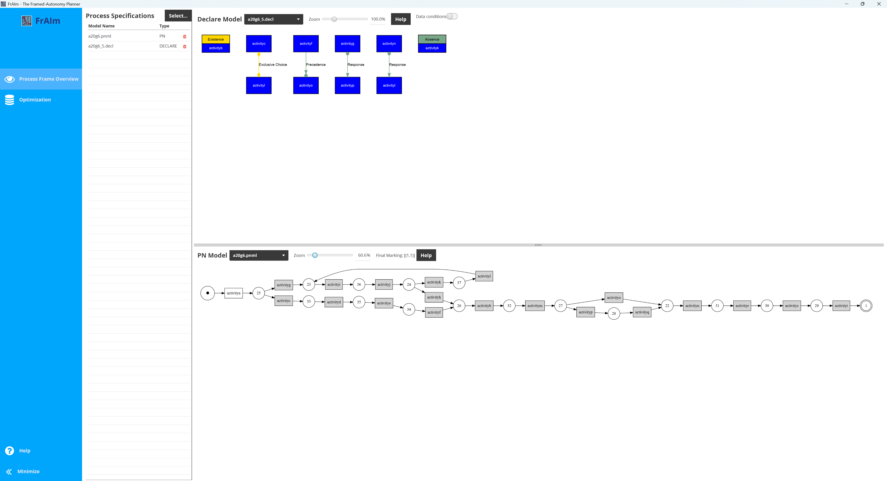

FrAIm is a java-based What-If-Analysis tool for framed autonomy. 

Framed Autonomy describes the capability of an AI-Augmented Business Process Management System (ABPMS) to _autonomously_ decide how a given partial process execution should continue.

The theoretical foundation is based on [Acitelli et al. (2025)](https://doi.org/10.1016/j.is.2025.102573) and [Wittlinger et al. (2026)](https://arxiv.org/abs/2607.16738). Both these paper describe an automata-theoretic technique for framed autonomy.

This version of FrAIm is specifically designed for multi-perspective process frames containing data and temporal conditions, with multi-objective optimization in mind. The possible optimization dimensions are (i) Contstraint Satisfaction (i.e. minimize the violation), (ii) Activity Cost, and (iii) Execution time.

FrAIm takes procedural process models in ".pnml" (Petri nets) and declarative process specifications in ".decl" format (Multi-Perspective DECLARE), and returns an optimal continuation for a given (possibly empty) prefix. 

